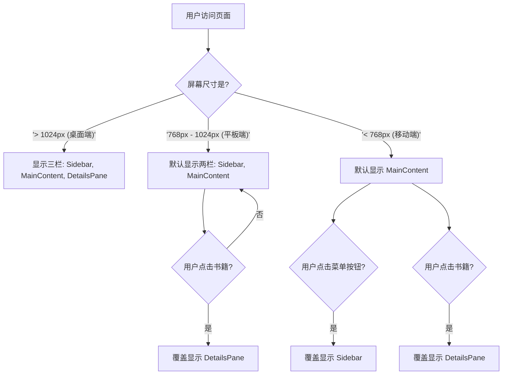

# 响应式改造计划

本计划旨在将项目现有固定宽度的三栏式布局改造为能够适配桌面、平板和移动端设备的响应式布局。

## 改造目标

1.  **桌面端 (大屏幕, > 1024px)**: 保持现有的三栏式布局（`Sidebar` + `MainContent` + `DetailsPane`）。
2.  **平板端 (中等屏幕, 768px - 1024px)**: 默认显示两栏（`Sidebar` + `MainContent`），`DetailsPane` 默认隐藏，可通过点击书籍触发显示。
3.  **移动端 (小屏幕, < 768px)**: 默认只显示 `MainContent`。`Sidebar` 和 `DetailsPane` 均默认隐藏，需要通过按钮点击来触发显示。

## 实施步骤

### 1. 在 Tailwind CSS 中定义响应式断点

为了在不同屏幕尺寸下应用不同的样式，我们需要在 `tailwind.config.js` 中定义标准的响应式断点。我们将使用 Tailwind CSS 的默认断点：`sm` (640px), `md` (768px), `lg` (1024px)。

### 2. 改造核心布局 `Layout.tsx`

这是响应式改造的核心。我们将修改 `Layout.tsx`，使其能够根据屏幕尺寸和传入的状态来动态调整其子组件（`Sidebar`, `MainContent`, `DetailsPane`）的显示和隐藏。

- **移动端**: 布局将变为 `flex-col`（垂直堆叠）或只显示当前活动的主要视图。
- **平板端和桌面端**: 布局保持 `flex-row`（水平排列），但 `Sidebar` 和 `DetailsPane` 的可见性将由状态控制。

### 3. 改造侧边栏 `Sidebar.tsx`

`Sidebar` 需要在小屏幕上能够被隐藏和显示。

- 添加一个关闭按钮，仅在移动端视图下显示。
- 使用 CSS `transform` 和 `transition` 来实现平滑的滑入/滑出效果。
- 其可见性将由从 `App.tsx` 传入的 `isSidebarOpen` 状态控制。

### 4. 改造详情区 `DetailsPane.tsx`

与 `Sidebar` 类似，`DetailsPane` 也需要在中、小屏幕上能够被隐藏和显示。

- 添加一个关闭按钮。
- 在中等屏幕下，当没有选中书籍时，它应该默认隐藏。
- 其可见性将由 `selectedBook` 和 `isDetailsPaneOpen` 状态共同决定。

### 5. 改造主内容区 `MainContent.tsx`

`MainContent` 将包含用于在移动端视图下触发 `Sidebar` 和 `DetailsPane` 显示的按钮。

- 在 `Header` 组件中添加一个“菜单”按钮，用于切换 `Sidebar` 的显示状态。
- 当选中一本书时，可以考虑在 `Header` 或其他地方添加一个“详情”按钮，用于在中小屏幕上显示 `DetailsPane`。

### 6. 在 `App.tsx` 中添加状态管理逻辑

我们需要在顶层组件 `App.tsx` 中添加新的状态来管理 `Sidebar` 和 `DetailsPane` 的可见性。

- `isSidebarOpen`: `boolean` 类型，控制 `Sidebar` 的显示/隐藏。
- `isDetailsPaneOpen`: `boolean` 类型，控制 `DetailsPane` 的显示/隐藏。
- 创建相应的 `toggleSidebar` 和 `toggleDetailsPane` 函数，并将它们传递给子组件。

## Mermaid 流程图示例

---

这个计划涵盖了从样式配置到组件逻辑修改的完整流程。您对这个计划满意吗？如果满意，我们就可以开始着手实施了。
