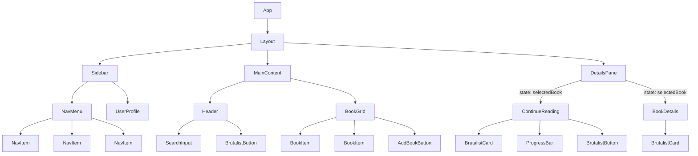

# 阅读器 APP React+TypeScript 开发计划

本文档基于 `index.html` 原型，旨在将项目拆分为 React + TypeScript 组件，并制定详细的开发步骤。

## 1. 组件拆分 (Component Breakdown)

根据原型分析，我们将应用拆分为以下可复用的 UI 组件：

- **`Layout`**: 整体三栏式布局容器。
- **`Sidebar`**: 左侧导航栏。
  - **`NavMenu`**: 导航菜单。
  - **`NavItem`**: 单个导航项。
  - **`UserProfile`**: 用户信息区域。
- **`MainContent`**: 中间主内容区。
  - **`Header`**: 内容区头部。
  - **`BookGrid`**: 书籍网格。
  - **`BookItem`**: 单个书籍项。
  - **`AddBookButton`**: 添加书籍按钮。
- **`DetailsPane`**: 右侧详情区。
  - **`ContinueReading`**: “继续阅读”卡片。
  - **`BookDetails`**: 书籍详情展示。
- **通用 UI Kit (Brutalist Style)**:
  - **`BrutalistButton`**: 风格化按钮。
  - **`BrutalistCard`**: 风格化卡片容器。
  - **`SearchInput`**: 搜索框。
  - **`ProgressBar`**: 进度条。

## 2. 组件层级结构与数据流

### 组件层级图

### 数据流 (State Management)

采用自上而下的单向数据流。

- **`App` (Root Component)**:

  - **State**:
    - `books: Book[]`: 书籍列表。
    - `user: User`: 用户信息。
    - `selectedBook: Book | null`: 当前选中的书籍。
    - `activeNav: string`: 当前激活的导航项。
  - **Actions**:
    - `handleSelectBook(book: Book)`
    - `handleNavChange(nav: string)`
    - `handleSearch(query: string)`
    - `handleSort()`

- **数据传递**: 状态和操作函数通过 props 从 `App` 组件向下传递给子组件。

## 3. 详细开发步骤 (Task Breakdown)

### 阶段一：环境搭建与基础构建

1.  **初始化项目**: 使用 Vite (`react-ts` 模板) 创建项目，并配置 Tailwind CSS。
2.  **定义数据结构**: 在 `src/types/types.ts` 中定义 `Book` 和 `User` 接口。
3.  **创建基础布局组件**: 实现 `Layout.tsx`, `Sidebar.tsx`, `MainContent.tsx`, `DetailsPane.tsx`。
4.  **创建通用 UI 组件**: 在 `src/components/ui/` 目录下创建 `BrutalistButton.tsx`, `BrutalistCard.tsx`, `SearchInput.tsx`, `ProgressBar.tsx`。

### 阶段二：核心功能组件开发

5.  **开发侧边栏**: 实现 `NavMenu.tsx`, `NavItem.tsx`, `UserProfile.tsx` 并组合到 `Sidebar.tsx` 中。
6.  **开发主内容区**: 实现 `Header.tsx`, `BookGrid.tsx`, `BookItem.tsx`, `AddBookButton.tsx` 并组合到 `MainContent.tsx` 中。
7.  **开发详情区**: 实现 `ContinueReading.tsx`, `BookDetails.tsx` 并组合到 `DetailsPane.tsx` 中，根据 props 动态显示。

### 阶段三：集成与状态管理

8.  **根组件 `App.tsx`**:
    - 定义并管理应用级状态 (`useState`)。
    - 创建模拟数据用于开发。
    - 实现状态更新函数。
9.  **Props 传递与集成**:
    - 将状态和事件处理函数作为 props 从 `App.tsx` 传递到各子组件。
    - 确保组件交互能正确更新应用状态。
10. **最终审查**: 代码审查、格式化、Linting，确保功能完整性和代码质量。
