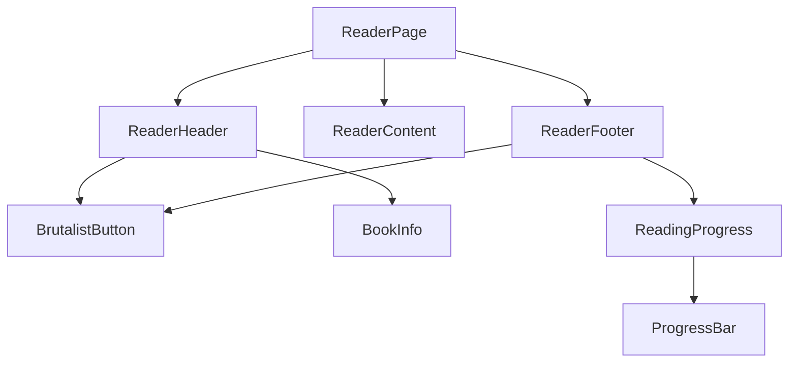

# React Reader Page Implementation Plan

This document outlines the plan to implement the reader page prototype from `backup/reader3.html` using React and TypeScript, integrating with the existing project structure and component library.

## 1. Component Breakdown

Based on the `reader3.html` file, the reader page can be broken down into the following components:

- **`ReaderPage.tsx`**: The main container component that will hold the header, content, and footer. It will manage the overall state, including the visibility of the toolbars.
- **`ReaderHeader.tsx`**: The top toolbar containing navigation buttons (Back to Shelf, Table of Contents) and book/chapter information.
- **`ReaderContent.tsx`**: The main area for displaying the book's text content. It will handle the scrolling and presentation of the chapter text.
- **`ReaderFooter.tsx`**: The bottom toolbar containing chapter navigation (Previous/Next) and the reading progress bar.
- **`BookInfo.tsx`**: A small component within the header to display the book title and current chapter name.
- **`ReadingProgress.tsx`**: A component within the footer to display the percentage and the progress bar.

## 2. Existing Component Analysis

The following existing components from `@/src/components/ui` will be reused:

- **`BrutalistButton.tsx`**: This component will be used for all buttons in the header and footer (`Back`, `TOC`, `Search`, `Settings`, `Previous Chapter`, `Next Chapter`). The `variant='primary'` prop can be used for the "Back" button.
- **`ProgressBar.tsx`**: This component is a perfect match for the reading progress bar in the footer.

## 3. New Component Implementation Plan

The new components will be created in the `src/components/reader/` directory.

### Task Steps:

1.  **Create `ReaderPage.tsx` at `src/pages/ReaderPage.tsx`**:

    - This will be the main page component.
    - It will use a state (`toolbarsVisible`) to control the visibility of the header and footer.
    - It will implement the logic to show/hide the toolbars based on mouse position (or touch events on mobile), similar to the original JavaScript.

2.  **Create `ReaderHeader.tsx` at `src/components/reader/ReaderHeader.tsx`**:

    - It will receive props for book title and chapter title.
    - It will use the existing `BrutalistButton` for its action buttons.
    - It will be styled to match the header in `reader3.html`, including the blur effect.

3.  **Create `ReaderContent.tsx` at `src/components/reader/ReaderContent.tsx`**:

    - It will receive the chapter content as a prop (e.g., HTML string or structured data).
    - It will be responsible for rendering the book content with the correct typography and layout.
    - It will handle its own internal scrolling.

4.  **Create `ReaderFooter.tsx` at `src/components/reader/ReaderFooter.tsx`**:

    - It will receive the current reading progress percentage as a prop.
    - It will use the existing `BrutalistButton` for next/previous chapter navigation.
    - It will use the existing `ProgressBar` component to display the reading progress.

5.  **Assemble the `ReaderPage`**:
    - Import `ReaderHeader`, `ReaderContent`, and `ReaderFooter` into `ReaderPage.tsx`.
    - Pass the necessary props down to the child components.
    - Add routing in `App.tsx` or the project's router to render `ReaderPage` at a specific path (e.g., `/read/:bookId`).

## 4. State Management

- **Local State**: The visibility of the toolbars will be managed by a local state within `ReaderPage.tsx`.
- **Props**: Data such as book content, chapter title, and reading progress will be passed down from a higher-level component (or a state management library like Redux/Zustand if the app uses one) to `ReaderPage` and then down to its children via props.

This plan provides a clear path to implementing the reader page while maximizing code reuse and maintaining consistency with the existing application architecture.
